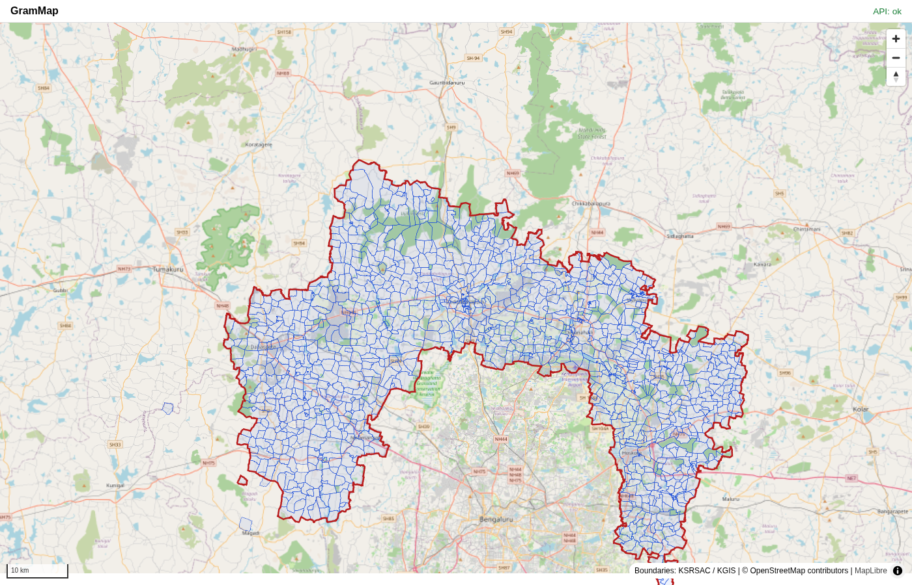

# S1.2 Village boundaries

- **Run:** PipelineRun 4, finished 2026-10-14 17:36 UTC
- **Source:** KGIS Village_Dynamic and Admin_Dynamic (district) layers, EPSG:4326
- **Join key:** LGD village code (present on every KGIS polygon); Census code checked

## Join rate

| Measure | Value |
|---|---|
| Pilot villages (LGD list) | 1,171 |
| With a boundary | 1,139 |
| **Join rate** | **97.3%** (target 90%) |
| Polygon Census code agrees with village Census code | 1,137 |
| KGIS features fetched | 1,241 |
| Multi-part villages merged | 75 |
| Invalid polygons repaired (make_valid) | 1 |
| Invalid after load | 0 |
| Village polygons whose interior point is outside the district | 3 |

## Areas (km²)

Median village 1.754, smallest 0.0595, largest 16.03. All village polygons 2,455.3 km² against a district area of 2,453.3 km².

## Villages without a boundary (32)

These are in LGD but have no KGIS polygon (mostly villages created after 2011). They get an approximate boundary from building clusters later (PRD Section 7.1).

625032 Sevanagara; 625041 Shivalinga Pura; 625646 Jadigenahalli; 910080 Mopurahalli (D); 910087 Hanagalapura (D); 910091 Ancharahalli (D); 910094 Kudihalli (D); 910098 Ramayyana Palya; 910207 Birayyanapalya; 910208 Bandayyanapalya; 910219 Boirasandra (Palya); 910221 Subramanya Ghati (D); 910223 Palapaladinne (D); 910224 Tiruvanahalli (D); 910230 Dinnur; 910246 Chikkamurali; 910253 Haliyur (D); 910258 Nagenahalli; 910262 Chikkahosahalli (D); 910264 Yarrappanahalli (D); 910273 Hallevooru (D); 910284 Ganjaralahalli (D); 910292 Venkatapur (B); 910484 Gollarahattii; 924477 Chikkakorati; 924490 Hattugunte Palya; 926008 Jyothipuraa; 948554 Dinne Soluru; 948555 Koira Hosur; 948556 P Ranganathpura; 948558 Seekayanahalli; 948559 Singawara

Examples of invalid_geometry_repaired: 625712 Mallasandra

## Map check

Village polygons (blue) from Martin vector tiles over the OSM basemap, with the district boundary
(red). Green patches inside the district without polygons are reserved forests, which are not
villages. The three small polygons outside the district to the west are the villages that LGD
places in Nelamangala but KGIS draws in Bengaluru South (see `S1_1_lgd_comparison.md`).
